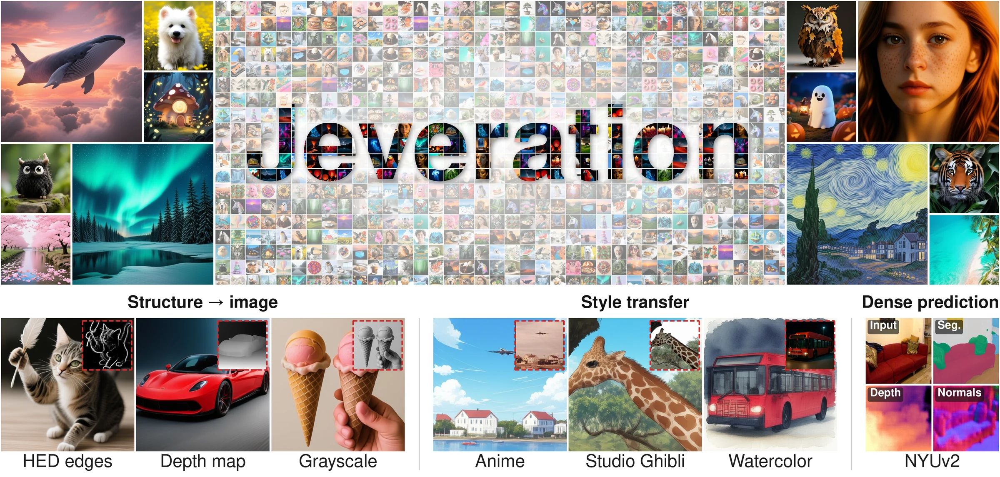

# Jeveration: System One Models Now Generate

[Paper](https://arxiv.org/abs/2611.24738) | [Project page](https://carol-lyh.github.io/Jeveration/) | [Weights](https://huggingface.co/linlinlinlinsdada/Jeveration) | [Demo](https://huggingface.co/spaces/linlinlinlinsdada/Jeveration)



Jeveration is a frozen vision-language model that returns a whole 512 x 512 image as one joint decision, in a
**single forward pass**: 78 ms for a text-to-image request on one NVIDIA H200. One checkpoint does text-to-image,
image-to-image (structure to image, colorization, style transfer) and dense prediction (segmentation, depth, surface
normals).

This repository contains the original inference code, plus an optional RGBD
decoder-side training extension.

### Native RGB + depth + normals: Colab training

[**Colab instructions, live metrics and Google Drive checkpoints**](docs/RGBD_TRAINING.md).
The extension trains a decoder sidecar using Jeveration's released depth/normal/
segmentation heads as teachers; it does not change the original RGB decoder.

```bash
pip install "git+https://github.com/Apache0ne/Jeveration.git"

# After mounting Google Drive in Colab and preparing RGBD features:
python -m jeveration.rgbd_train fit \
  --root /content/jev_rgbd \
  --save-dir /content/drive/MyDrive/Jeveration_RGBD/checkpoints \
  --save-every 250 --save-at 1100,2250,3750 \
  --log-every 10 --steps 4000
```

The trainer displays a live progress bar, saves full resumable training states
at chosen steps, and writes TensorBoard and JSONL metrics to Drive. The
validation set is exactly 20 held-out images. See the guide for preparation
and resuming from Drive.

## Setup

Python 3.12 and a CUDA GPU.

```bash
pip install -r requirements.txt
hf download linlinlinlinsdada/Jeveration --local-dir weights     # 6.5 GB
```

The backbone (Qwen3.5-4B), the TA-TiTok tokenizer and CLIP's text tower are downloaded from the Hugging Face Hub on
first use.

## Usage

**Text-to-image**

```bash
python generate.py --weights weights/jeveration.pt --decoder weights/decoder512.pt \
    --prompt "A stone cottage with a thatched roof and a flower garden in the countryside." --seed 0 --out samples/
```

**Image-to-image**

| `--task` | `--image` |
|---|---|
| `hed`, `depth` | an edge map (white on black) or a depth map (bright = near), with a `--caption` of the wanted image. With `--from-photo`, a photo: its map is computed first. |
| `colorize` | a photo, read as a grey picture |
| `anime`, `ghibli`, `watercolor` | a photo |

```bash
python image_to_image.py --weights weights/jeveration.pt --source-decoder weights/source_decoder512.pt \
    --task hed --image examples/hed_puppy.png --out puppy.png \
    --caption "A fluffy white Samoyed puppy smiling in a field of yellow flowers on a sunny afternoon."
python image_to_image.py --weights weights/jeveration.pt --source-decoder weights/source_decoder512.pt \
    --task watercolor --image examples/photo_snowcabin.jpg --out watercolor.png
```

**Dense prediction** (trained on NYUv2: indoor scenes)

```bash
python dense_predict.py --weights weights/jeveration.pt --image examples/room_1.png --out room_dense/
```

**Python**, all tasks from one pipeline (run from the repository's folder, the inputs are in `examples/`)

```python
import numpy as np
from PIL import Image
from jeveration import JeverationPipeline
from jeveration.images import load_square, to_gray

pipe = JeverationPipeline("weights/jeveration.pt", decoder="weights/decoder512.pt",
                          source_decoder="weights/source_decoder512.pt")

# Text-to-image: a list of prompts -> uint8 images [B, 512, 512, 3]
prompt = "A lone pine tree on a small island in a calm lake at dawn."
images = pipe.text_to_image([prompt], pipe.generator(0))
Image.fromarray(images[0]).save("pine.png")

# Structure to image: an edge map ("hed") or a depth map ("depth"), with a caption of the wanted image
edges = load_square("examples/hed_puppy.png")
caption = "A fluffy white Samoyed puppy smiling in a field of yellow flowers on a sunny afternoon."
images = pipe.image_to_image(edges[None], "hed", [caption], generator=pipe.generator(0))
Image.fromarray(images[0]).save("puppy.png")

# Colorization of a grey picture
gray = to_gray(load_square("examples/gray_pancakes.jpg"))
images = pipe.image_to_image(gray[None], "colorize", generator=pipe.generator(0))
Image.fromarray(images[0]).save("pancakes.png")

# Style transfer of a photo: "anime", "ghibli" or "watercolor"
photo = load_square("examples/photo_snowcabin.jpg")
images = pipe.image_to_image(photo[None], "watercolor", generator=pipe.generator(0))
Image.fromarray(images[0]).save("watercolor.png")

# Dense prediction: class index, depth in meters and surface normal of every pixel
room = np.asarray(Image.open("examples/room_1.png").convert("RGB"))
pred = pipe.dense_predict(room[None])        # {"seg": [B, H, W], "depth": [B, H, W], "normal": [B, H, W, 3]}
```

**Web demo** with the three tasks in the browser, each with examples to try. Install Gradio with
`pip install gradio -c requirements.txt`, which keeps the pinned versions.

```bash
python app.py --weights weights/jeveration.pt --decoder weights/decoder512.pt \
    --source-decoder weights/source_decoder512.pt        # add --share for a temporary public link
```

Every script lists its options with `--help`. A seed gives the same image in every run on the same hardware and
software.

## License

The code and the Jeveration weights are released under the Apache License 2.0 (`LICENSE`, `NOTICE`). Third-party code
and the models downloaded at run time keep their own licenses (`THIRD_PARTY_NOTICES.md`).

## Citation

```bibtex
@article{liu2026jeveration,
  title   = {Jeveration: System One Models Now Generate},
  author  = {Liu, Yuhe and Li, Qi and Zhang, Shihua and Wang, Xinchao},
  journal = {arXiv preprint arXiv:2611.24738},
  year    = {2026}
}
```
